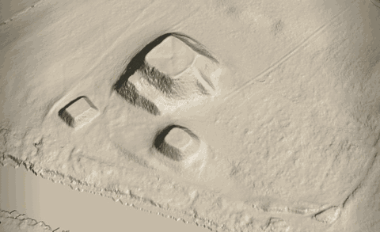

## ☁️ What I do

I'm a Senior Cloud Engineer at a Premier Google Cloud partner. Companies hand me their cloud problems, and I try to hand back something that runs fine without me.

- **Architecture and migrations.** I work out where everything should live while trying to avoid as many headaches as possible
- **Infrastructure and automation.** I work alongside many of the major CICD and Cloud Providers to strengthen what's in place.
- **Data and ML platforms.** I get data to where it's useful, and models out of the notebook and in front of people.
- **Gemini and AI agents.** I put Gemini Enterprise to work on a company's own data and build agents that hold up after the demo.

## 🎓 Certifications

## 🚀 Cloud in practice

<table>
  <tr>
    <td width="50%" valign="top">
      <h3>Archaeohub, a full app on AWS</h3>
      
A full web app I run end to end: containers on EC2, Cognito for sign-in with a Lambda check, S3 for storage, Bedrock and Rekognition for the AI features, and a GitHub Actions pipeline that deploys on every push.

      
    </td>
    <td width="50%" valign="top">
      <h3>GA Mound Detector</h3>
      
A deep learning model that reads public USGS LiDAR and flags likely earthen mounds. Open source, with trained weights in the release.

      
    </td>
  </tr>
</table>

## Off the clock ⚽

- **Soccer.** FC Barcelona fan. Visca el Barça! 🔵🔴
- **Archaeology.** It's where I point the cloud skills. The scan below is Etowah Mounds in Georgia, seen through LiDAR with the trees stripped away.

Elevation data: USGS 3DEP. More on <a href="https://www.youtube.com/@archaeohubofficial">YouTube</a>.

